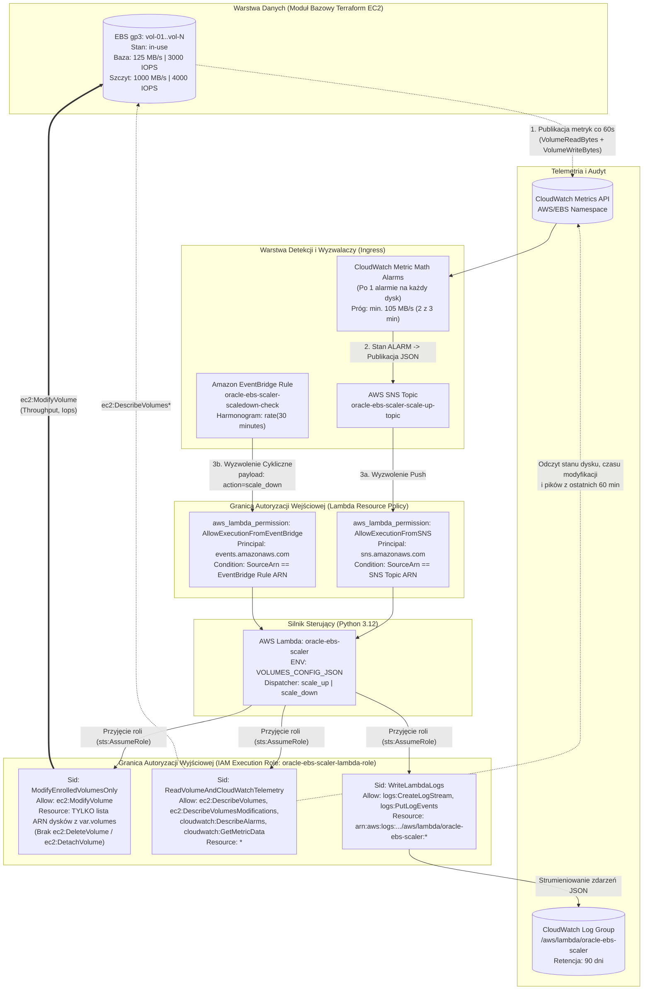
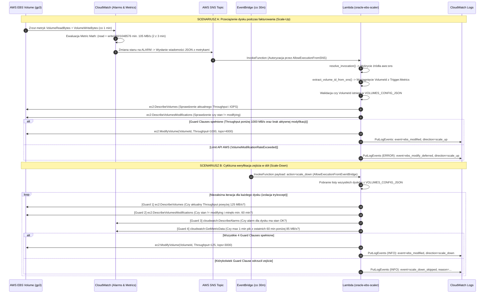

# Architektura Techniczna, Przepływ Danych i Model Uprawnień IAM

Dokument opisuje szczegółowy przepływ sygnałów sterujących, strukturę payloadów JSON oraz granice autoryzacji IAM w układzie **AWS EBS gp3 Auto-Throughput Scaler (Multi-Volume Sidecar Control Plane)**.

---

## 1. Topologia Systemu i Granice IAM (Schemat Terminalowy ASCII)

```text
====================================================================================================
                  ŚCIEŻKA 1: REAKTYWNY SCALE-UP (PUSH / EVENT-DRIVEN, ~2-3 MIN)
====================================================================================================

 [ Wolumeny EBS gp3 (Oracle DB) ]
   │  (vol-01, vol-02, ..., vol-07)
   │
   │ 1. Strumień telemetrii I/O co 60s (VolumeReadBytes, VolumeWriteBytes)
   ▼
 [ CloudWatch Metric Math Alarms (for_each = var.volumes) ]
   │  Wzór: (m_read + m_write) / 60 / 1048576 >= 105 MB/s (2 z 3 punktów)
   │
   │ 2. Zmiana stanu OK -> ALARM: Publikacja JSON (SNS:Publish)
   ▼
 [ Wspólny Temat SNS: oracle-ebs-scaler-scale-up-topic ]
   │
   │ 3. Asynchroniczny Push (lambda:InvokeFunction)
   │    🛡️ Autoryzacja Wejściowa: Lambda Resource Policy (AllowExecutionFromSNS, SourceArn=SNS_ARN)
   ▼
====================================================================================================
                  CENTRALNY SILNIK STERUJĄCY: AWS LAMBDA (oracle-ebs-scaler)
                  Konfiguracja w RAM: VOLUMES_CONFIG_JSON (mapa wszystkich dysków)
                  🛡️ Tożsamość Wyjściowa: sts:AssumeRole -> oracle-ebs-scaler-lambda-role
====================================================================================================
   ▲                                      │                           │                        │
   │ 4. Cykliczny Trigger co 30 min       │ 5. Telemetria (Read-Only) │ 6. Zmiana QoS (Write)  │ 7. Audyt JSON
   │    Payload: {"action": "scale_down"} │    Uprawnienia IAM:       │    Uprawnienia IAM:    │    Uprawnienia IAM:
   │    🛡️ Autoryzacja Wejściowa:         │    - ec2:DescribeVolumes* │    - ec2:ModifyVolume  │    - logs:CreateLogStream
   │    Lambda Resource Policy            │    - cw:DescribeAlarms    │    Tylko dla jawnej    │    - logs:PutLogEvents
   │    (AllowExecutionFromEventBridge)   │    - cw:GetMetricData     │    listy ARN z tfvars! │    Zasób: /aws/lambda/*
   │    Zasób: *                          ▼                           ▼                        ▼
 [ EventBridge Scheduler ]          [ CloudWatch & EC2 API ]    [ EBS Control Plane ]    [ CloudWatch Logs ]
   (rate(30 minutes))                 (Weryfikacja 4 Guard        (Podbicie do 1000 MB/s   (/aws/lambda/
                                       Clauses przed zejściem)     lub zejście do 125 MB/s) oracle-ebs-scaler)
====================================================================================================
                  ŚCIEŻKA 2: PROAKTYWNY SCALE-DOWN (BATCH POLLING CO 30 MIN)
====================================================================================================
```

---

## 2. Diagram Komponentów i Granic Bezpieczeństwa IAM (Mermaid.js)



---

## 3. Diagram Sekwencji i Walidacji Guard Clauses (Mermaid.js)



---

## 4. Szczegółowa Matryca Komunikacji, Payloadów i Uprawnień

| Krok | Nadawca (Źródło) | Odbiorca (Cel) | Mechanizm Autoryzacji (IAM / Policy) | Przesyłane Dane (Payload) | Walidacja i Reakcja Odbiorcy |
|---|---|---|---|---|---|
| **1** | **EBS Hypervisor (Nitro)** | **CloudWatch Metrics** | Wewnętrzny mechanizm AWS Control Plane (bezpłatny strumień `AWS/EBS`). | Surowe liczniki bajtów: `VolumeReadBytes` oraz `VolumeWriteBytes` (Sum, okres 60s). | Agregacja danych w szeregach czasowych przypisanych do wymiaru `VolumeId`. |
| **2** | **CloudWatch Alarm** | **SNS Topic** (`*-scale-up-topic`) | Wbudowana rola serwisowa CloudWatch Alarms. | Obiekt JSON stanu alarmu (`NewStateValue: "ALARM"`, tablica `Trigger.Metrics` z zaszytym `VolumeId`). | Temat SNS przyjmuje wiadomość i natychmiast rozsyła ją do zasubskrybowanych endpointów. |
| **3a** | **SNS Topic** | **AWS Lambda** (`oracle-ebs-scaler`) | **Lambda Resource Policy:** `AllowExecutionFromSNS` (`Principal: sns.amazonaws.com`, weryfikacja `SourceArn`). | Koperta SNS (`Records[0].EventSource == "aws:sns"`), wewnątrz zserializowany JSON z CloudWatcha. | Funkcja `extract_volume_id_from_sns()` parsuje zagnieżdżone wymiary Metric Math, weryfikuje obecność dysku w `VOLUMES_CONFIG_JSON` i kieruje wywołanie do `scale_up_single_volume()`. |
| **3b** | **EventBridge Rule** (`rate(30 minutes)`) | **AWS Lambda** (`oracle-ebs-scaler`) | **Lambda Resource Policy:** `AllowExecutionFromEventBridge` (`Principal: events.amazonaws.com`, weryfikacja `SourceArn`). | Statyczny obiekt JSON: `{"action": "scale_down"}`. | Funkcja `resolve_invocation()` kieruje ruch przez `ACTION_DISPATCHER` do pętli wsadowej `handle_scale_down_dispatch()`, która bada każdy dysk z osobna. |
| **4** | **AWS Lambda** | **EC2 API & CloudWatch API** | **IAM Execution Role:** `oracle-ebs-scaler-lambda-role` (polityka `ReadVolumeAndCloudWatchTelemetry`, `Resource: "*"`). | Zapytania HTTPS podpisane SigV4: `DescribeVolumes`, `DescribeVolumesModifications`, `DescribeAlarms`, `GetMetricData`. | Sprawdzenie 4 warunków brzegowych (Guard Clauses): aktualnego pasma, braku statusu `modifying`, upływu 60 minut od ostatniej zmiany, stanu `OK` na alarmie oraz maksymalnego piku z ostatnich 60 min poniżej 85 MB/s. |
| **5** | **AWS Lambda** | **AWS EBS Control Plane** | **IAM Execution Role:** `oracle-ebs-scaler-lambda-role` (polityka `ModifyEnrolledVolumesOnly`, `Resource:` **wyłącznie jawna lista ARN dysków z Terraforma**). | Wywołanie `ec2:ModifyVolume` z parametrami `VolumeId`, `Throughput` (1000 lub 125) oraz `Iops` (4000 lub 3000). | Kontroler EBS online przydziela lub zwalnia pasmo na łączu Nitro bez restartu EC2 i bez przerywania transakcji Oracle DB. W razie przekroczenia limitu API (6h cooldown), wyjątek `VolumeModificationRateExceeded` jest łagodnie przechwytywany (model EAFP). |
| **6** | **AWS Lambda** | **CloudWatch Logs** | **IAM Execution Role:** `oracle-ebs-scaler-lambda-role` (polityka `WriteLambdaLogs` ograniczona do `/aws/lambda/oracle-ebs-scaler:*`). | Ustrukturyzowany rekord JSON (`event`, `volume_id`, `direction`, `reason`, `max_mbps`). | Zapis w strumieniu logów z retencją 90 dni pod audyt operacyjny i skrypt `ops_control.sh logs`. |
